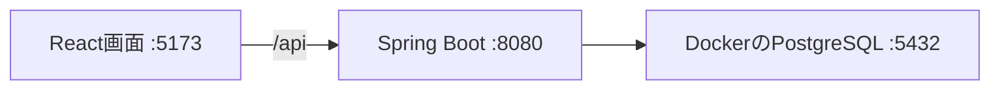

# ゲーム募集掲示板

Java/Spring Boot、React/TypeScript、PostgreSQLを使う学習用Webアプリ。
現在はアカウント登録・ログイン・ログアウト・本人確認を実装済み。
ゲーム募集・参加の機能は次の開発対象。



## ローカル起動

Linux/WSL x86_64、Node.js 22.12以上の22系、DockerとCompose、Python 3が必要。
Dockerを実行できるユーザーで、リポジトリルートから次を実行する。

```bash
./scripts/install-local-jdk.sh
./scripts/init-local-env.sh
docker compose up -d --wait db
./scripts/run-backend.sh
```

別のターミナルで画面を起動する。

```bash
cd frontend
npm ci
npm run dev
```

http://localhost:5173/register で登録し、ログイン画面へ進む。
`.env`はローカルの秘密設定で、Gitには含めない。生成したJWTやパスワードもログへ記録しない。

仕様・設計・全テストの実行方法は[authガイド](specs/001-auth/quickstart.md)、
API契約は[schema/auth/openapi.yaml](schema/auth/openapi.yaml)を参照。
