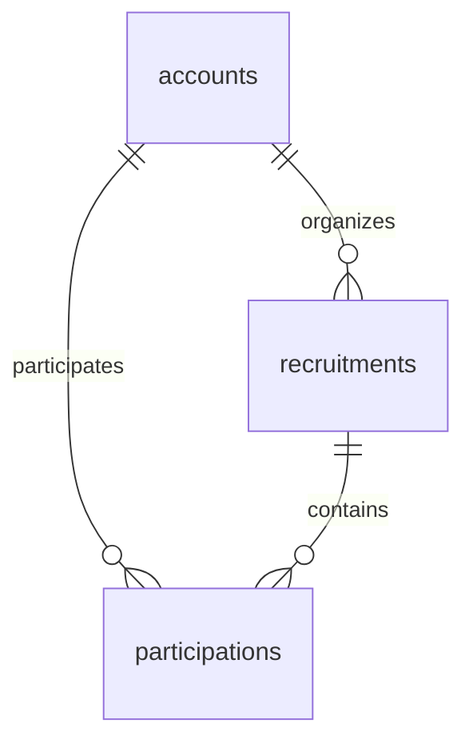

# 掲示板のデータ設計

正本: [spec.md](spec.md)。認証情報は[アカウント設計](../001-auth/data-model.md)が管理する。

## Game（固定値）

| API/保存コード | 表示名 |
| --- | --- |
| VALORANT | VALORANT |
| APEX_LEGENDS | Apex Legends |
| OVERWATCH | Overwatch |

Java enumとGET /gamesから提供する。DB CHECKも同じ3値とし、テストで一致を保証する。追加/編集画面・gamesテーブルは不要。

## recruitments（V3）

| 項目 | 保存形式 | 制約 |
| --- | --- | --- |
| id | uuid | PRIMARY KEY |
| organizer_id | uuid | NOT NULL、accounts.id外部キー、ON DELETE RESTRICT |
| game | varchar(20) | NOT NULL、上の3コードのみCHECK |
| title | varchar(100) | NOT NULL、char_length 1〜100 |
| description | varchar(2000) | NOT NULL、char_length 1〜2000 |
| starts_at | timestamptz | NOT NULL、秒/小数秒0。作成成立の判定時刻より未来をapplicationで検証 |
| capacity | smallint | NOT NULL、1〜9のCHECK、募集者を含めない |
| meeting_info | varchar(1000) | NOT NULL、default空文字、最大1000 |
| manually_closed | boolean | NOT NULL、default false |
| cancelled | boolean | NOT NULL、default false |
| created_at | timestamptz | NOT NULL、Clockから設定 |

タイトル・募集文のUnicode White_Spaceのみ不可をdomainで検証。前後の文字・改行・大小を自動で変更しない。合流情報は任意で、空文字/White_Spaceのみなら空文字（未登録）へ正規化する。NULLはHTTP/保存とも使用しない。

インデックス: `(starts_at, created_at, id)`、`(game, starts_at, created_at, id)`、`(organizer_id, starts_at, created_at, id)`。件数が少なくてもまず仕様の検索/並びに対応するこの範囲に限定し、後の実測前に更なる最適化はしない。

## participations（V4）

| 項目 | 保存形式 | 制約 |
| --- | --- | --- |
| recruitment_id | uuid | NOT NULL、recruitments.id外部キー、ON DELETE RESTRICT |
| account_id | uuid | NOT NULL、accounts.id外部キー、ON DELETE RESTRICT |
| joined_at | timestamptz | NOT NULL、Clockから設定 |

`PRIMARY KEY (recruitment_id, account_id)`で重複を防ぐ。`(account_id, recruitment_id)`をマイページ用に追加する。参加順は`joined_at ASC, account_id ASC`で固定。
キャンセルはこの行をDELETEし、キャンセル履歴の提供や退会機能は追加しない。募集者の参加はdomainで拒否する。
参加人数は行数からCOUNTする。保存カウンターは作らず、増減の二重管理を避ける。

## Relationships

公開プロフィールはaccounts.id/display_nameだけ。login_id/password_hash/created_atは募集のレスポンスに含めない。

## 状態の導出（保存enumなし）

1. `cancelled`ならCANCELLED。
2. `now >= starts_at`ならSTARTED。
3. `manually_closed`ならMANUALLY_CLOSED。
4. `participantCount == capacity`ならFULL。
5. その他はOPEN。

時刻は差し替えClock、カウントは現在の参加行から取得。開始時刻を過ぎただけでSQL UPDATEするジョブは不要。中止は過去になってもCANCELLED。

| 操作 | 本人/状態/時刻 | 保存変更 |
| --- | --- | --- |
| 作成 | ログイン済み、有効入力、未来 | 親行INSERT、参加0、両フラグfalse |
| 参加 | 募集者以外、未参加、OPEN | 本人の参加行INSERT |
| キャンセル | 参加者本人、開始前。中止/manual/full可 | 本人の参加行DELETE、親フラグは維持 |
| 締め切り | 募集者、開始前、中止前。FULL可 | manually_closed=true |
| 再開 | 募集者、開始前、中止前、manualClosed、空きあり | manually_closed=false |
| 中止 | 募集者、開始前、中止前 | cancelled=true、参加行は保持 |
| 合流情報編集 | 募集者、開始前、中止前。FULL/manual可 | meeting_infoのみ更新 |

同じ締め切りの再要求は条件を満たせば成功し人数不変。すでに中止/開始済みの管理は409。未参加のキャンセルは409。重複参加は409で行を増やさない。

## 変更トランザクション

READ COMMITTEDと、同一親行のSELECT FOR UPDATEを使う。
親行ロック後の別SQLで人数・参加関係を読んでから、domainへ募集・本人UUID・count・Clock値を渡して判断する。
ロック取得SQLにCOUNT/EXISTSを混ぜない（待機前snapshotの値を使わない）。すべての更新経路が親行→参加行の順でアクセスする。
一意制約は防御であり、定員はこの直列化で守る。失敗時はrollback、commit失敗503、成功応答はcommit後。

時刻はロック待機後と終了直前で再確認する。受付条件はトランザクション内の最終条件検証時点で成立し、物理commit時刻との同時保証はしない。作成も入力受信時だけでなくINSERT前と終了直前で未来性を確認する。
登録された合流情報や募集文を例外ログへ出さない。

## 読み取りの整合性

- 公開詳細: 単一SQLで親/募集者プロフィール/参加者プロフィール/countをsnapshot取得。返すparticipants.lengthとcountは一致し、同じClock値で状態を決める。
- 公開一覧: cancelled=false、manually_closed=false、starts_at>now、count<capacityで絞る。`starts_at ASC, created_at ASC, id ASC`、20+1行。次ページの有無だけ返し、総件数は不要。
- 一覧pageは1始まり。offsetは(page-1)*20、overflowを防ぎ不正は400。ページ間は別時点の最新一覧なので、同時変更による移動は許容しカーソルや過去snapshotは導入しない。
- マイページ: kind=created/participating、period=upcoming/past。upcomingはstarts_at>now、pastはstarts_at<=now。中止は時刻区分に残す。開始前は昇順、過去はstarts_at DESC/created_at DESC/id DESC。各20件。キャンセル済み行は存在せず参加一覧から消える。
- 合流情報: READ COMMITTED/readOnly=falseの短期transactionで親行FOR SHARE後、別SQLで本人の参加を確認して時刻を読む。募集者は全状態で閲覧可。参加者は開始前かつ中止前のみ。未参加/キャンセル済み403、未ログイン401。返答前の最終権限・時刻確認を行う。これ以後のキャンセルと既存応答のコピーは取り消さない。

## 入力と日時

- テキストはUnicodeコードポイント、White_Space集合は認証の方針と同じ。不正なサロゲートを拒否。
- capacityはJSON整数のみ。小数/文字列/真偽値を整数へ暗黙変換しない。未知JSON項目と型違いは400。
- startsAtはoffset必須のRFC3339文字列。実在日時をstrict解析し、秒/小数秒は0とする。UTC Instantへ変換し、応答はUTCのZ形式。Reactはdatetime-localの入力文字列に+09:00を明示して送り、OSのタイムゾーンで解釈しない。表示はIntlのtimeZone=Asia/Tokyo。
- 追加の将来日上限は設けない。JSON/OpenAPIのdate-timeとして表現可能な日時を扱う。
- クライアント検証に加えてdomain/applicationで未来・文字数・状態を保証する。

## 初期化

専用game_recruitment_contractの名前確認を既存SQLに残し、participations→recruitments→revoked_tokens/accountsを一括TRUNCATEで整合させる。
RESTRICT外部キーは通常運用の削除防止。テストでは関連表すべてを同一TRUNCATEに明示し、CASCADE任せで範囲を広げない。固定Game enumは初期化で消えない。
実装後に同じIDで登録・作成・参加を2回確認する。通常利用者向けの削除/初期化APIは作らない。

共通の`backend/src/test/java/com/gamerecruitment/account/ApiTestSupport.java`もTRUNCATE対象へ2つの関連表を追加する。authのテストだけでも新しいFKが適用されるため、accountsだけを初期化してはならない。テスト用の別PostgreSQLだけを対象とする。
